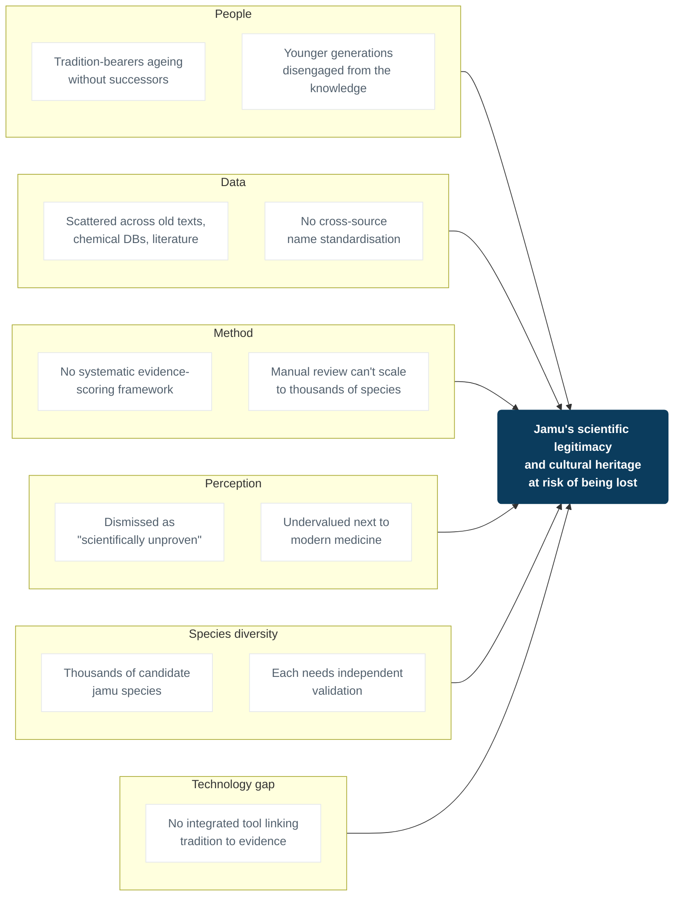
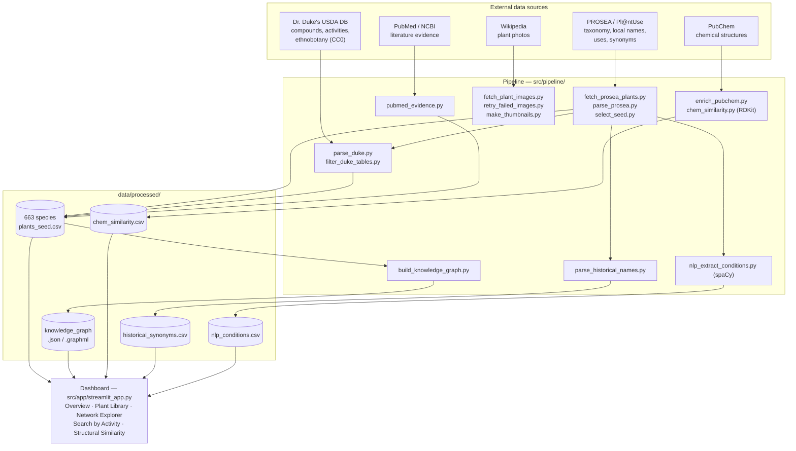
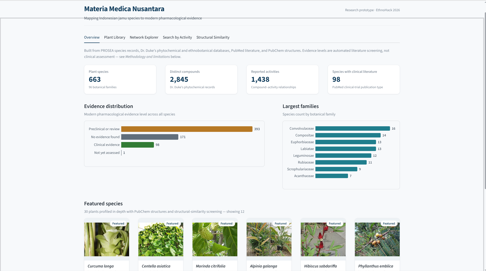
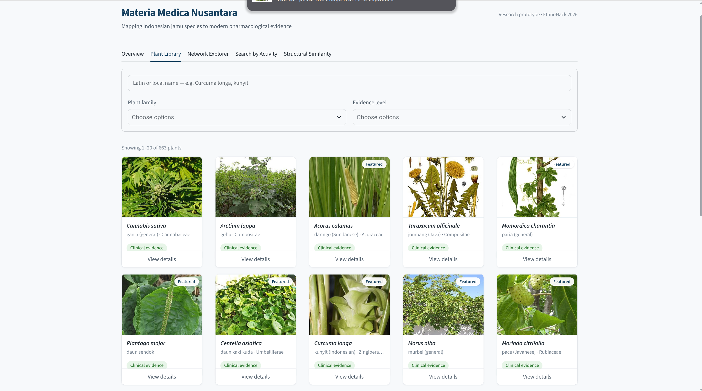
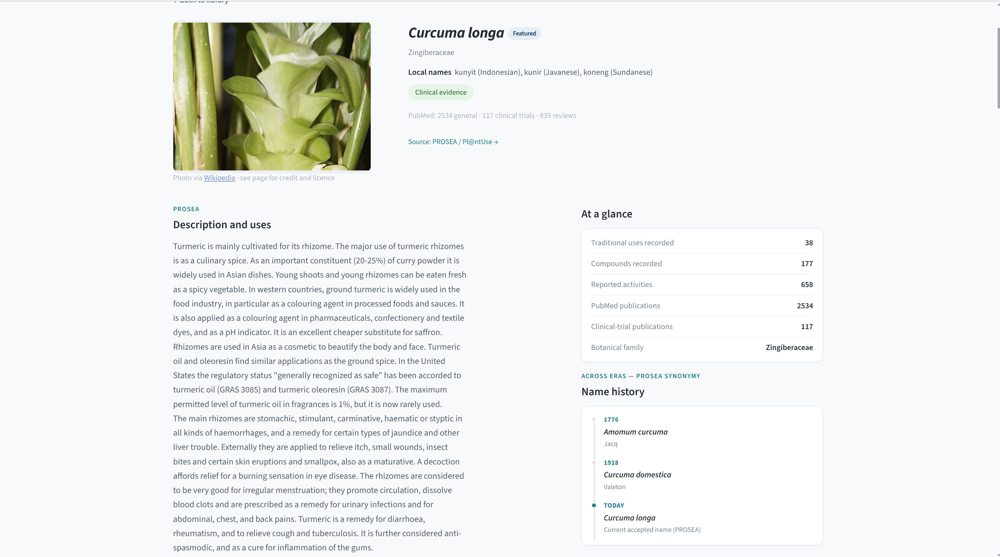
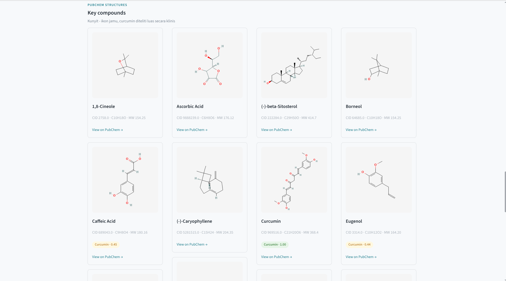
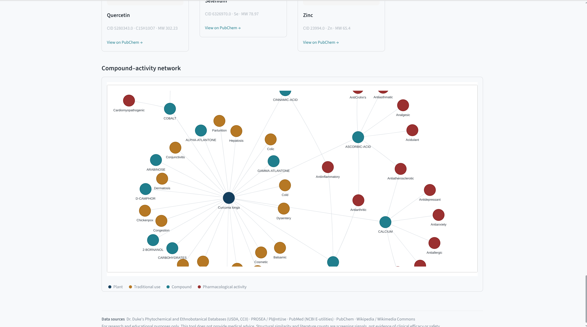
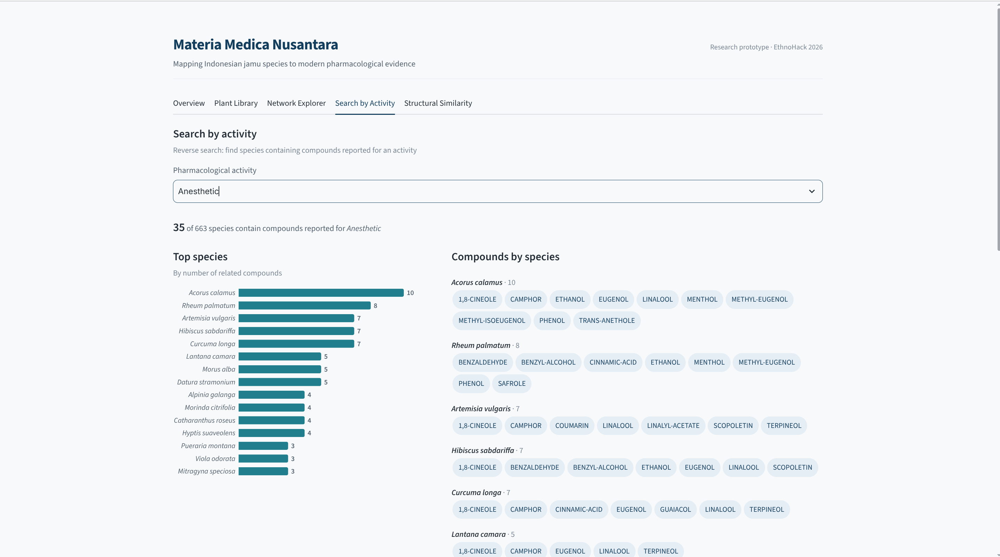
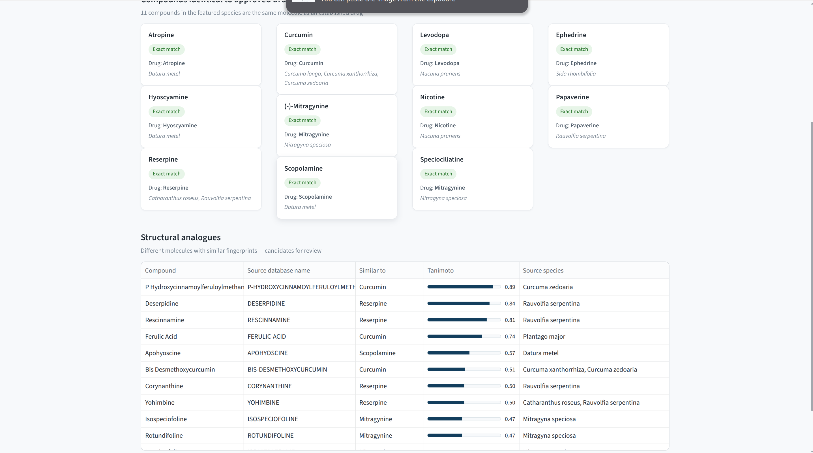

# Materia Medica Nusantara

**EthnoHack 2026 — Track: Traditional Knowledge** (with elements of Natural Products & Drug Discovery)

Mapping 663 scientifically documented Indonesian *jamu* (traditional medicine) plant species to
modern pharmacological evidence — compounds, biological activities, PubMed literature, PubChem
structures, and a cheminformatics similarity model (RDKit) — plus two text-mining layers that
extract knowledge directly from free text: a scientific-name timeline spanning two and a half
centuries, and condition/symptom extraction from archaic ethnobotanical prose. Everything is
exposed through an interactive knowledge graph and a public-facing dashboard.

## Table of contents

- [Problem statement](#problem-statement)
- [Why this matters — root-cause analysis](#why-this-matters--root-cause-analysis)
- [What this project does](#what-this-project-does)
- [Architecture](#architecture)
- [Screenshots](#screenshots)
- [Repository structure](#repository-structure)
- [Data sources & licences](#data-sources--licences)
- [Setup](#setup)
- [Running the pipeline](#running-the-pipeline)
- [Running the dashboard](#running-the-dashboard)
- [Methodology notes](#methodology-notes)
- [Limitations & responsible research](#limitations--responsible-research)
- [Results at a glance](#results-at-a-glance)
- [Roadmap](#roadmap)
- [Team](#team)

## Problem statement

*Jamu* knowledge is vast but scattered — ethnobotanical surveys, global phytochemical databases,
and pharmacology literature rarely talk to each other. There is no single place that answers a
simple question: for a given traditional claim ("plant X is used for Y"), is there modern
pharmacological evidence behind it, and how strong is it? This project builds that bridge
automatically and transparently, including being explicit about when evidence has *not* been
found — without asserting medical claims the data doesn't support.

## Why this matters — root-cause analysis

*Jamu* is a living heritage of the Indonesian archipelago, but it's losing ground for several
independent reasons at once. Laid out as a fishbone (Ishikawa) diagram, with "jamu's scientific
legitimacy and cultural heritage at risk" as the effect:



Materia Medica Nusantara directly targets the **Data**, **Method**, and **Technology** bones —
turning scattered sources into one systematically scored, auditable map — on the theory that
closing those gaps is also the fastest way to push back on the **Perception** bone: nothing
legitimises traditional knowledge faster than being able to point at real, citable evidence.

## What this project does

- **Curates 663 species** from PROSEA (Plant Resources of South-East Asia) with a confirmed
  Indonesian vernacular name, ranked by how complete their downstream data is.
- **Links each species** to phytochemical and ethnobotanical records from Dr. Duke's USDA
  database, and scores an automated PubMed evidence tier (clinical / preclinical / not found).
- **Resolves real compound structures** from PubChem for 30 "flagship" species, and runs an
  RDKit Tanimoto-similarity screen against 40 approved/classic reference drugs — separating
  molecules that are *identical* to an existing drug from ones that are merely *similar*.
- **Mines free text with NLP**, not just structured tags: a parser recovers 1,021 dated historical
  scientific names (1753–present) from PROSEA's synonymy sections, and a spaCy `PhraseMatcher`
  over a curated 14-category lexicon extracts 2,313 condition mentions directly from archaic
  pharmacological prose ("stomachic", "emmenagogue", "febrifuge") that a modern biomedical NER
  model would not recognise.
- **Assembles a knowledge graph** (Plant → TraditionalUse / Compound → Activity) and serves all of
  the above through a Streamlit dashboard.

## Architecture



Knowledge graph schema:

```
Plant --TRADITIONAL_USE--> TraditionalUse   (Dr. Duke's ETHNOBOT, by country + reference)
Plant --CONTAINS-->        Chemical         (Dr. Duke's FARMACY_NEW)
Chemical --HAS_ACTIVITY--> Activity         (Dr. Duke's AGGREGAC — the "modern pharmacology" layer)
Plant.evidence_tier        <- automated PubMed query (NCBI E-utilities)
Plant.historical_names     <- parsed from PROSEA's Synonyms sections
Plant.nlp_conditions       <- spaCy PhraseMatcher over PROSEA's free-text "Uses" paragraph
```

## Screenshots

**Overview** — dataset scale, evidence distribution, and featured species at a glance.



**Plant Library** — searchable, filterable photo gallery across all 663 species.



**Plant detail** — per-species page with the historical name timeline (*Curcuma longa* traced
from *Amomum curcuma*, 1776, to its current name) alongside live PubMed and compound counts.



**Key compounds** — for the 30 flagship species, real PubChem structures with similarity-model
badges (e.g. caffeic acid flagged as 0.45 similar to curcumin).



**Network Explorer** — interactive compound–activity knowledge graph for a single species.



**Search by Activity** — reverse search from a pharmacological activity to candidate species and
their compounds.



**Structural Similarity** — the RDKit model's full results: compounds identical to approved drugs,
and structural analogues ranked by Tanimoto score.



## Repository structure

```
.
├── README.md
├── requirements.txt
├── .streamlit/config.toml        # dashboard theme
├── asset/                        # dashboard screenshots used in this README
├── data/
│   └── processed/                # curated outputs checked into the repo (data/raw/ is not)
├── docs/
│   └── DASHBOARD.md               # tab-by-tab layout reference for the dashboard
└── src/
    ├── pipeline/                  # one script per pipeline stage (see Architecture above)
    └── app/
        ├── streamlit_app.py       # data loading, graph building, page composition
        ├── styles.py              # design tokens, CSS, reusable UI components
        └── static/plant_thumbs/   # pre-cropped plant photos served by the dashboard
```

`data/raw/` (bulk downloads such as the Duke's CSV dump and raw PROSEA wikitext) and a few large
intermediate files are intentionally not committed — see `.gitignore` — because they're fully
regenerable by re-running the pipeline scripts below.

## Data sources & licences

| Source | Content | Licence / access |
|---|---|---|
| [PROSEA via Pl@ntUse](https://plantuse.plantnet.org/en/Category:Medicinal_plants_(PROSEA)) | Scientific names, Indonesian local names, traditional-use descriptions, dated historical synonyms | Academic wiki content (PROSEA Foundation); **licence not explicitly confirmed on the wiki itself** — used here as a non-commercial research prototype with a per-page source citation. Re-verify before any wider redistribution. |
| [Dr. Duke's Phytochemical and Ethnobotanical Databases](https://dx.doi.org/10.15482/USDA.ADC/1239279) (USDA/ARS) | Ethnobotanical uses by country, compounds per plant, pharmacological activities per compound, all with literature references | **CC0 (Public Domain)** |
| [PubMed / NCBI E-utilities](https://www.ncbi.nlm.nih.gov/books/NBK25501/) | Modern-literature publication counts (general / clinical trial / review) per species, for the evidence tier | Public API access (used at a polite, rate-limited pace) |
| [PubChem PUG REST](https://pubchem.ncbi.nlm.nih.gov/docs/pug-rest) | Compound structures, SMILES, formula, molecular weight | Public API access |
| [Wikipedia REST API](https://en.wikipedia.org/api/rest_v1/) / Wikimedia Commons | Representative photo per species | Licence varies per image (CC-BY-SA / public domain) — see the credit link shown with each photo in the dashboard |

## Setup

```bash
# Python dependencies — uv is recommended (faster than plain pip)
uv venv .venv && source .venv/bin/activate
uv pip install -r requirements.txt
```

## Running the pipeline

Run in this order. `parse_duke.py` requires `Duke-Source-CSV.zip` from Ag Data Commons
(https://dx.doi.org/10.15482/USDA.ADC/1239279) extracted to `data/raw/duke/extracted/`.

```bash
python src/pipeline/fetch_prosea_plants.py
python src/pipeline/parse_duke.py
python src/pipeline/parse_prosea.py
python src/pipeline/select_seed.py
python src/pipeline/filter_duke_tables.py
python src/pipeline/pubmed_evidence.py
python src/pipeline/fetch_plant_images.py
python src/pipeline/retry_failed_images.py   # optional: re-fetch images rate-limited on first pass
python src/pipeline/make_thumbnails.py
python src/pipeline/enrich_pubchem.py
python src/pipeline/chem_similarity.py
python src/pipeline/parse_historical_names.py
python src/pipeline/nlp_extract_conditions.py
python src/pipeline/build_knowledge_graph.py
```

Each script's module docstring documents its exact inputs and outputs.

## Running the dashboard

```bash
streamlit run src/app/streamlit_app.py
```

Five tabs: **Overview** (dataset statistics and evidence distribution), **Plant Library** (photo
gallery + per-species detail page, including the historical name timeline and NLP-extracted
conditions), **Network Explorer** (interactive knowledge graph per species), **Search by Activity**
(reverse search from a pharmacological activity to candidate species), and **Structural
Similarity** (the RDKit model's results). Full tab-by-tab layout is documented in
[`docs/DASHBOARD.md`](docs/DASHBOARD.md).

## Methodology notes

**Evidence tiers** (`pubmed_evidence.py`) are assigned per species from automated PubMed queries,
not manual literature review:

- `clinical_evidence` — a clinical-trial/RCT publication type was found for this species name.
- `preclinical_or_review_evidence` — pharmacology/bioactivity or review publications were found,
  but no clinical trial.
- `traditional_only_no_modern_lit_found` — our automated query returned nothing. **This is not
  evidence that a plant is inactive** — it may simply mean the literature doesn't match our query
  terms, is written in another language, or the species hasn't been studied yet.

**NLP condition extraction** (`nlp_extract_conditions.py`) uses a hand-curated, 14-category lexicon
matched with spaCy's `PhraseMatcher` (tokenizer-aware, not naive substring search) because PROSEA's
prose uses archaic pharmacological register that no general-purpose or biomedical NER model
reliably recognises. This is a deliberate, scoped tool, not a trained classifier — its coverage is
limited to the terms in the lexicon.

**Structural similarity** (`chem_similarity.py`) converts PubChem SMILES into Morgan fingerprints
(RDKit, radius 2, 2048 bits) and compares them via Tanimoto similarity against 40 reference drugs.
Note that 2D fingerprints cannot distinguish stereoisomers, so two molecules that differ only in
3D configuration can register as an "identical" match — this is disclosed in the dashboard itself,
not hidden.

## Limitations & responsible research

- This is a **research prototype**, not medical guidance. No efficacy claims are made from this
  data.
- The 663 species are every PROSEA candidate with a documented Indonesian name — not a random
  sample, and not an exhaustive list of all jamu plants used in Indonesia.
- Dr. Duke's database was last updated around 2015–2016; newer compound/activity findings are not
  reflected in that layer (though they are captured by the PubMed evidence-tier layer).
- Cross-source name matching is done by genus/species string match, not validated against a
  taxonomic authority (e.g. GBIF/WFO) — spelling variants or synonyms may cause missed matches.
- The NLP condition lexicon and the similarity reference-drug list are both curated lists, not
  exhaustive or learned from data.

## Results at a glance

| Metric | Value |
|---|---|
| Species | 663, across 96 botanical families |
| Distinct compounds | 2,845 |
| Compound–activity relationships | 1,438 |
| Evidence tier | 98 clinical · 393 preclinical/review · 171 not found · 1 not yet assessed |
| Flagship species (PubChem + similarity) | 30 |
| Compounds identical to an approved drug | 11 (e.g. levodopa, reserpine, mitragynine) |
| Structural analogues flagged | 21 |
| Species with a dated historical name | 490 (1,021 names, 1753–present) |
| Species with NLP-extracted conditions | 611 (2,313 condition mentions, 14 categories) |

## Roadmap

- Expand beyond 663 species to the full set of documented jamu plants.
- Grow the flagship/similarity-screened set past 30 species.
- Replace the hand-built NLP lexicon with a model trained on historical pharmacological text.
- Validate "structural analogue" findings with pharmacognosy researchers in the lab.

## Team

- *(add team member names here)*
